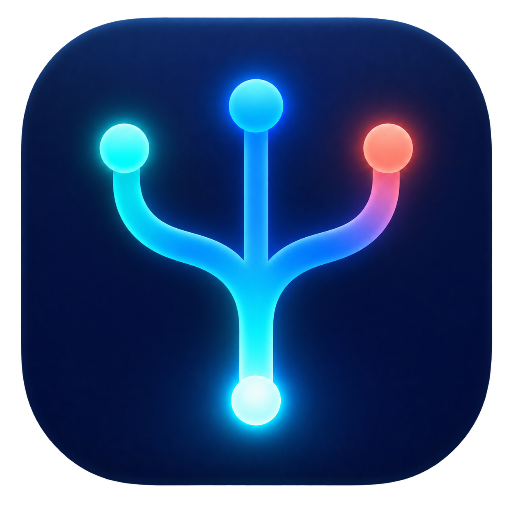

<div align="center">



# Fork Lite

**VPN и прокси в строке меню macOS.**

Восемь протоколов, подписки, правила маршрутизации и живые соединения в одном приложении.


[**Скачать ForkLite.app.zip**](https://raw.githubusercontent.com/piksel-man231/fork_lite/main/ForkLite.app.zip) · [Исходный код](Sources) · [Сборка](#сборка-из-исходников)

</div>

---

## Возможности

- **Один переключатель в строке меню** — подключение запускается вручную; после перезапуска приложения оно остаётся выключенным.
- **Несколько форматов профилей** — ссылки, Clash YAML, подписки, импорт из Clash Verge и файлы WireGuard.
- **Правила сверху вниз** — домены, IP-подсети, процессы и порты можно направить через выбранный сервер, напрямую или заблокировать.
- **Активные соединения** — узел, процесс, выход, скорость и объём трафика; правила создаются правым кликом по соединению.
- **Выбор по задержке** — TCP-пинг и автоматический выбор среди TCP-серверов до включения туннеля. Для UDP-протоколов такой пинг не используется.

## Протоколы и импорт

| Протокол | Что импортировать |
| --- | --- |
| VLESS | `vless://`, Clash YAML; `tcp`, `ws`, `xhttp`, Reality и TLS |
| VMess | `vmess://` (Base64 JSON), Clash YAML |
| Trojan | `trojan://`, Clash YAML |
| Shadowsocks | `ss://`, Clash YAML |
| Hysteria2 | `hysteria2://`, `hy2://`, Clash YAML |
| TUIC | `tuic://`, Clash YAML |
| WireGuard | стандартный `.conf` через кнопку **«Из файла…»** |
| AmneziaWG | `.conf` в нативном формате AmneziaWG через **«Из файла…»** |

Ключи Amnezia `vpn://` и файлы `.vpn` предназначены для приложения AmneziaVPN и здесь не импортируются. Для AmneziaWG экспортируйте конфигурацию в **AmneziaWG native format** (`.conf`). Сейчас поддерживается один `[Peer]` в файле.

Конфигурации всех восьми протоколов проверены локально. Для AmneziaWG также проверен разбор параметров утилитой `awg`; живое подключение к серверу пока не проверялось.

```text
Приложения Mac
      │
      ▼
  TUN · sing-box
      │
      ├─ ваши правила ──► выбранный сервер / напрямую / блок
      └─ остальной трафик ──► выбранный сервер
```

При выключении подключения TUN останавливается. WireGuard работает через endpoint sing-box, AmneziaWG — через отдельный движок с интерфейсом `utun`. Все движки, в том числе sing-box и Xray для `xhttp`, лежат внутри скачиваемого `.app`.

## Установка

1. [Скачайте ForkLite.app.zip](https://raw.githubusercontent.com/piksel-man231/fork_lite/main/ForkLite.app.zip) и распакуйте архив.
2. Перенесите **ForkLite.app** в `/Applications` и откройте его.
3. Добавьте профиль на вкладке **«Серверы»**: вставьте ссылку, добавьте подписку или нажмите **«Из файла…»**.
4. Включите **«Подключение»** в строке меню. При первом включении приложение предложит установить помощник и запросит пароль администратора Mac.

Homebrew для скачанного приложения не нужен. Приложение подписано ad hoc подписью и не нотариализовано Apple. Если macOS не откроет его с первого раза, разрешите запуск в **Системных настройках → Конфиденциальность и безопасность**.

## Правила

Правила применяются **сверху вниз**. Если совпадений нет, трафик идёт через выбранный сервер. Правила с выходом **«Сервер»** пропускаются, когда подключение выключено.
В новой установке список правил пуст. Для прямого доступа к локальным подсетям при включённом туннеле добавьте нужные CIDR-правила самостоятельно.

| Условие | Пример | Выход |
| --- | --- | --- |
| Домен или поддомены | `example.com` | Сервер / напрямую / блок |
| Домен содержит | `example` | Сервер / напрямую / блок |
| IP-подсеть | `192.168.0.0/16` | Сервер / напрямую / блок |
| Процесс | `Safari` | Сервер / напрямую / блок |
| Порт | `443` | Сервер / напрямую / блок |

## Сборка из исходников

Понадобятся macOS 14+ и Swift 5.9+. Репозиторий содержит бинарники движков для Apple Silicon и исходники этих движков в [`vendor/source`](vendor/source).

```sh
git clone https://github.com/piksel-man231/fork_lite.git
cd fork_lite
./scripts/build-app.sh
open ForkLite.app
```

Скрипт собирает Swift-приложение в release-режиме, упаковывает движки и помощник в `.app` и подписывает пакет ad hoc подписью. Готовый каталог [ForkLite.app](ForkLite.app) также хранится в репозитории; для скачивания одним файлом используйте ZIP выше.

## Файлы приложения

| Данные | Путь |
| --- | --- |
| Настройки, профили и конфигурация | `~/Library/Application Support/Fork Lite/` |
| Root-помощник и движки после первого включения | `/usr/local/fork_lite/` |

Fork Lite использует отдельные каталоги и не меняет данные обычного Fork. Профили и ссылки подписок хранятся локально.

---

<div align="center">

SwiftUI · [sing-box](https://sing-box.sagernet.org/) · [Xray-core](https://github.com/XTLS/Xray-core) · [AmneziaWG](https://github.com/amnezia-vpn/amneziawg-go)

</div>
